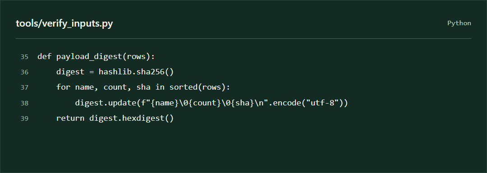

# Disc Port Toolkit

English · [Italiano](docs/languages/it.md) · [Français](docs/languages/fr.md) · [Deutsch](docs/languages/de.md) · [Español](docs/languages/es.md) · [日本語](docs/languages/ja.md)

Build *BLiNX: The Time Sweeper* from your own PAL disc on a 64-bit Windows 10 or 11 PC.

## Start here

1. Open the cloned toolkit folder, or extract the source ZIP into a short folder such as `C:\Blinx`. Double-click **`START_HERE.cmd`**.
2. Choose **Windows Clone 1** or **Android Original**.
3. Select your PAL game-partition image (`.iso` or `.xiso`). If you already extracted the disc, it can stay anywhere on your PC or on another drive. In the file picker, open the disc folder and select **`default.xbe`**. For example, if `D:\Games\Blinx PAL\` contains `default.xbe` and `media\` side by side, select `D:\Games\Blinx PAL\default.xbe`.

Keep the complete contents of `media/` in their original locations. Together with `default.xbe`, the PAL game contains 3,092 files. If the launcher reports `disc files differ from the reference`, follow the [disc check guide](docs/TROUBLESHOOTING.md#pal-disc-files-differ-from-the-reference) before extracting the disc again. The launcher reuses the tools it already installed.

The first build downloads missing tools and sources. On a new Android SDK installation, review the Google licence prompt. Windows opens the game when ready. Android opens the folder containing the APK. Copy the APK to your ARM64 Android device and open it there to install.

Each slow step shows its own progress bar. A percentage with ~ is an estimate. The elapsed time keeps updating during quiet steps. A step reaches 100% when it finishes successfully.

| Profile | How to start | Result |
| --- | --- | --- |
| [Windows Clone 1](docs/BUILD_WINDOWS.md) | Choose **Windows Clone 1** | Plays on the PC. Use `run_windows.cmd` next time. |
| [Android Original](docs/BUILD_ANDROID_ORIGINAL.md) | Choose **Android Original** | The PAL game with touch controls, in `dist/android-original/android-original.apk`. |
| [Android Full](docs/BUILD_ANDROID_FULL.md) | Follow the Full guide and run `build_android_full.cmd` | A separate hub for Original Game and the OXM12 demo. It also requires the demo disc, private hub resources and your signing identity. |

## Run one command

In a Windows command prompt inside the toolkit folder, run the line for your profile. Replace the example path with your image or extracted disc folder.

```bat
START_HERE.cmd windows "D:\Discs\Blinx.iso"
```

```bat
START_HERE.cmd android-original "D:\Discs\Blinx.iso"
```

Use `-NoLaunch` for a build without opening the result. For an existing copy of the pinned hakuX v1.3.0 APK, add `-HakuApk "D:\Apps\hakuX-1.3.0.apk"` to the Android command. The launcher otherwise obtains the matching release and checks the two ARM64 libraries before use. Keep the private signing identity under `cache/local-signing/` for future Android updates. The Android target requires Android 9 or later, ARM64 and Vulkan 1.1.

The [offline project guide](preview/index.html) is available in six languages. The individual build guides also describe the manual commands and offline inputs. To check a fresh source ZIP before building, use `verify_repository.cmd --no-git` with Python installed. For a clean Git checkout, use `verify_repository.cmd`.

This unofficial, source-only toolkit is independent of Microsoft, Xbox, Artoon and hakuX. Both Android profiles use pinned native libraries. Rebuilding those libraries from their complete corresponding source remains open.

## Code preview

The disc verifier hashes the path, size and contents of every disc file in a stable order. This excerpt comes from the toolkit’s own Python source.



## Build guides and reference

- [Windows Clone 1 sources and build guide](docs/BUILD_WINDOWS.md)
- [Android Original, controller support and disc import](docs/BUILD_ANDROID_ORIGINAL.md)
- [Android Full, resource inventory and local signing](docs/BUILD_ANDROID_FULL.md)
- [Build details](docs/FINAL_AUDIT.md) and [troubleshooting](docs/TROUBLESHOOTING.md)
- [License map](LICENSES.md), [component notices](NOTICE.md), [asset policy](ASSET_POLICY.md) and [publication checklist](docs/PUBLICATION_CHECKLIST.md)
- [File map](docs/FILE_MAP.md), [excluded items](docs/EXCLUSIONS.md) and [historical timestamp scope](provenance/OTS_STATUS_CURRENT.md)

Keep built APKs and the Windows executable in your personal workspace. The APKs embed your disc files, and the Windows executable contains locally translated game code.
